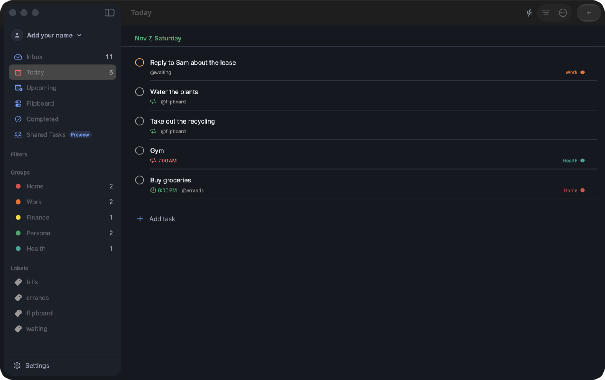
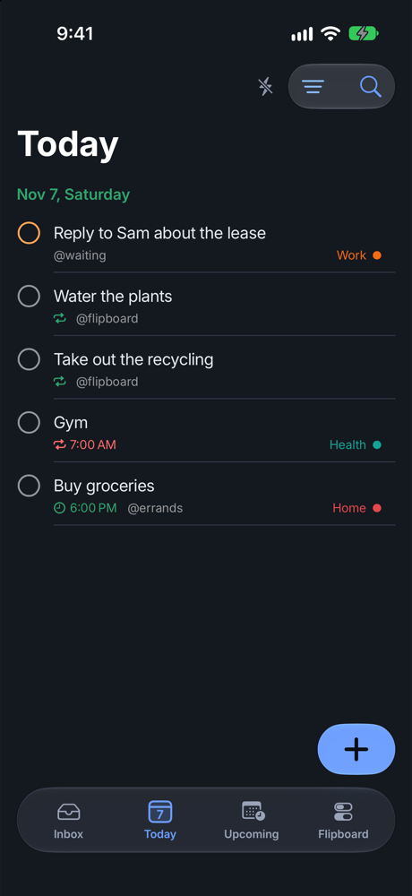

# HITList

[](https://github.com/Aeronyx/HITList/actions/workflows/tests.yml)

A task manager for iPhone, iPad and Mac. You type tasks the way you would say them, filter them with a
small query language, and they sync through your own iCloud account. There is no server and no account
to create.

HITList is in beta on TestFlight.
[Privacy policy](https://aeronyx.github.io/HITList/privacy/) ·
[Using it with Claude](https://aeronyx.github.io/HITList/claude/) ·
[Changelog](CHANGELOG.md)

<p align="center">
  
  
</p>

## What it does

- **Quick add.** `Pay rent tomorrow 5pm p1 #Finance @bills every month !1hb` becomes a dated, repeating,
  labelled task with a reminder an hour before. Recognised phrases are highlighted as you type, and
  tapping a highlight turns it back into plain text. Repeats read a place in the month or year too:
  `every month on the 28th`, `every 3 months on the 10th`, `quarterly`, `every last day of the month`,
  `every first Monday`, `every year on Mar 3`.
- **Filters.** `(p1 | p2) & next 7 days & !@waiting`, `#Work & no date`, `due before: next mon`. A saved
  filter is a list like any other.
- **Views.** Inbox, Today, Upcoming (a list on iPhone, a seven-day board on Mac and iPad), Browse, and
  Flipboard: a wall of switches for recurring chores that turn red again when they come due.
- **Sub-tasks, repeats, reminders, deadlines.** Repeats keep their wall-clock time across daylight-saving
  changes and land on the right day at month ends.
- **Shared Tasks (preview).** Lists shared with other people through CloudKit sharing.
- **Claude connector.** An MCP server inside the Mac app lets Claude Desktop or Claude Code list, add,
  complete and edit the tasks you choose to expose. It is off by default and cannot delete anything.
- **System integration.** Siri and Shortcuts, Spotlight, local notifications, and layouts for the
  foldable iPhone.

## How it is put together

| Path | Contents |
|------|----------|
| `HITListCore/` | Swift package with no UI and no persistence: the quick-add parser, date expressions, recurrence, the filter language, list ordering, the backup format and the MCP wire types. About 4,000 lines, about 300 tests, runs in seconds. |
| `HITList/` | The SwiftUI app (iOS 18, macOS 15). `Models/` holds the SwiftData models and schema versions, `Services/` sync monitoring, notifications, sharing, intents and the Claude connector, `Support/DesignSystem/` the components every screen is built from. |
| `HITListMCP/` | `hitlist-mcp`, the command-line helper Claude launches. It forwards each tool call to the running app. |
| `HITListTests/`, `HITListUITests/` | App tests, hosted in the app against an in-memory store, run on macOS and the iPhone simulator; a few XCUITest flows. |
| `scripts/` | `test.sh`, `release.sh`, and two helpers that screenshot and drive a Debug build on the Mac. |
| `docs/` | The GitHub Pages site: privacy policy and the Claude setup guide. |
| `dev/` | How the work is run: handbook, roadmap, the original design and the task briefs. |

A few decisions shape most of the code.

**Sync without a backend.** Tasks live in SwiftData and mirror to the user's private CloudKit database,
so there is nothing to host and no user data to hold. The cost is that the production schema can only
ever grow. Every model change is a new `VersionedSchema` with a lightweight migration, tests pin each
shipped version's entity hashes, and `release.sh` refuses to upload while the Development and Production
schemas differ.

**Sync you can inspect.** CloudKit mirroring is opaque when it stalls, so the app keeps a bounded
on-device sync log and a watchdog that records an error when an export or import has not followed a
change within seconds. Settings shows the environment, the log and, when sync is stuck, a way out.
Debug builds use their own store and the Development environment, so development never touches real
data.

**Shared lists kept apart.** SwiftData cannot use CloudKit's shared database, so Shared Tasks has its own
container, synced with `CKSyncEngine` and `CKShare` and merged field by field. A problem there cannot
disturb the main store.

**Language logic in a package.** Dates, repeats and filters are pure functions of text, a clock and a
calendar. Tests inject both, which is how spring-forward nights, month ends, leap days and week-start
rules are covered without waiting for them.

**A narrow door for Claude.** The helper speaks MCP over stdio and reaches the app through a local
message port guarded by a per-launch token. The app decides per call what a model may see, by label,
and there is no delete tool.

## Building

```bash
brew install xcodegen
xcodegen generate
open HITList.xcodeproj
```

The Xcode project is generated from `project.yml`; edit that, not the project file. Signing, the bundle
identifier and the two CloudKit containers are the author's. To run your own copy, change
`DEVELOPMENT_TEAM` and `bundleIdPrefix` in `project.yml` and the container identifiers in the
entitlements files. Xcode 26 or later.

A Debug build launched on a side store with `-seedDemoData` fills it with the week in the screenshots above
(`HITLIST_STORE_SUFFIX=demo`, `-disableCloudKit YES -seedDemoData`); it never touches the real store.

## Testing

```bash
scripts/test.sh          # package, macOS app tests, iPhone simulator app tests
scripts/test.sh core     # the package alone
scripts/test.sh ui       # XCUITest flows on the simulator
```

Each suite prints one summary line and the script exits non-zero on any failure. App tests run against
an in-memory store and skip CloudKit, so they never touch real data. CI runs the package and the macOS
suite, unsigned, on every push to `master`.

## Releasing

```bash
scripts/release.sh --version X.Y.Z
```

The script checks both CloudKit containers for schema drift before it changes anything, bumps the
build number, runs the tests, archives and uploads the iOS and macOS builds to App Store Connect, then
commits and tags. It needs a `## X.Y.Z` section in `CHANGELOG.md` first.

## How it is built

HITList is designed and directed by George Trammell and written with Claude Code. Each TestFlight build
gets used daily and comes back as a list of notes; those become written briefs with an owner, a file
list and a definition of done; agent sessions implement the briefs in separate git worktrees, tests
first; the branches are merged, the suites run, the app is driven on the simulator and the Mac, and only
then does a build go out. `dev/` holds the handbook for that process and every brief.
